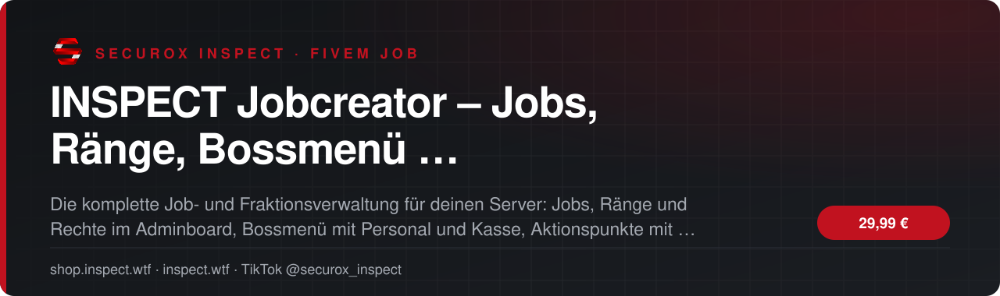
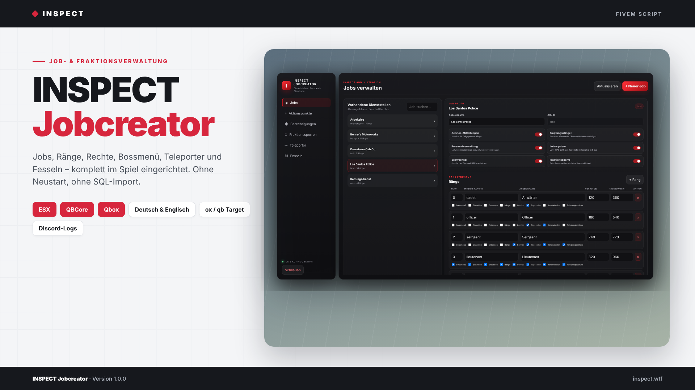
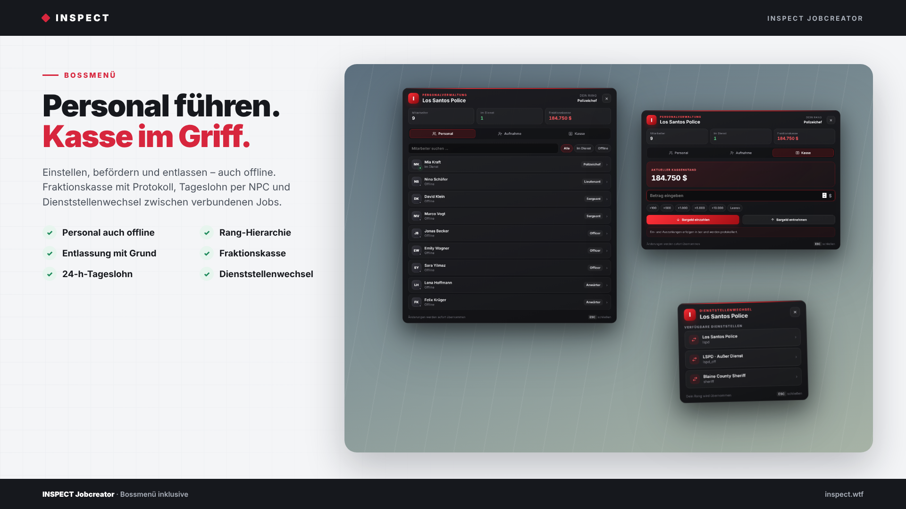
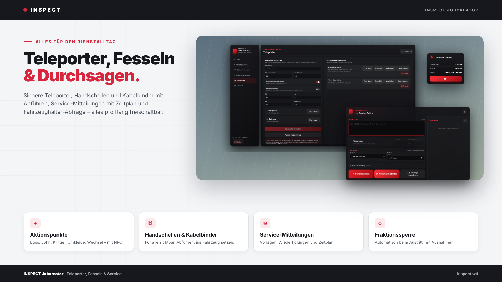

<!-- inspect-showcase: automatisch erzeugt, Änderungen bitte im Shop vornehmen -->

  
  
  
  
  

  
  
  

 

> 🇬🇧 **English:** INSPECT Jobcreator – Jobs, Ränge, Bossmenü, Teleporter und Fesseln komplett im Spiel verwalten – FiveM script (ESX, QBCore, Qbox) by SecuroX Inspect. Purchase and licensing exclusively at [shop.inspect.wtf](https://shop.inspect.wtf). Product details below are in German – questions are welcome on [Discord](https://discord.gg/inspect).

 

## Das Wichtigste auf einen Blick

<table>
  <tr>
    <td width="50%" valign="top">✔&nbsp; <b>Kompatibilität · ESX Legacy, QBCore und Qbox mit automatischer Framework-Erkennung</b></td>
    <td width="50%" valign="top">✔&nbsp; <b>Kompatibilität · ox_target oder qb-target, automatisch erkannt</b></td>
  </tr>
  <tr>
    <td width="50%" valign="top">✔&nbsp; <b>Kompatibilität · ox_inventory, qs-inventory, jaksam_inventory, qb-, ps- und lj-inventory oder Framework-Inventar</b></td>
    <td width="50%" valign="top">✔&nbsp; <b>Kompatibilität · Umkleide über illenium-appearance, fivem-appearance, qb-clothing oder esx_skin</b></td>
  </tr>
</table>

## Überblick

Jobs ohne Datenbank und ohne Neustart.

Neue Fraktion, neuer Rang, andere Rechte – auf den meisten Servern heißt das: SQL öffnen, Dateien anpassen, Server neu starten. INSPECT Jobcreator verlegt die komplette Job- und Fraktionsverwaltung ins Spiel. Jede Änderung ist sofort aktiv.

Adminboard  
Jobs anlegen, umbenennen und löschen, Ränge mit Gehalt und Tageslohn pflegen und pro Rang festlegen, wer das Bossmenü öffnen, einstellen, entlassen, befördern, Service-Mitteilungen senden, Handschellen nutzen oder Fahrzeughalter abfragen darf.

Aktionspunkte mit NPC  
Personalverwaltung, Lohnauszahlung, Empfangsklingel, Umkleide und Dienststellenwechsel werden per Ghost-Vorschau direkt am Ort platziert – mit frei wählbarem NPC-Modell und Szenario.

Bossmenü  
Personal mit Suche und Filter, Rang ändern, Entlassen mit Pflichtgrund – auch wenn der Mitarbeiter offline ist. Aufnahme von Personen im Umkreis, Fraktionskasse mit Ein- und Auszahlung. Die Rang-Hierarchie wird serverseitig geprüft.

Dienstalltag  
Sichere Teleporter mit Radius, Höhentoleranz und Marker, Handschellen und Kabelbinder mit Abführen und Fahrzeug-Aktionen, Service-Mitteilungen mit Vorlagen und Zeitplan, Empfangsklingel an Dienststelle oder einzelne Personen und eine Fraktionssperre beim Austritt.

Technik  
ESX Legacy, QBCore und Qbox werden automatisch erkannt, ebenso Target- und Inventar-System. Alle Tabellen legt das Script selbst an. Discord-Logs für jede Aktion, komplett auf Deutsch und Englisch.

Voraussetzungen: ox_lib, oxmysql und OneSync.

## Kompatibilität

| | |
|:--|:--|
| Frameworks | **ESX** · **QBCore** · **Qbox** |
| Unterstützte Ressourcen | `ox_inventory` · `ox_target` · `qb-target` |
| Plattform | FiveM (GTA V) |

## Alle weiteren Funktionen

- Adminboard · Jobs anlegen, umbenennen und löschen – sofort aktiv, ohne Neustart
- Adminboard · Ränge mit Gehalt und Tageslohn pro Rang
- Adminboard · Rangrechte für Bossmenü, Einstellen, Entlassen, Befördern, Service, Lohn, Handschellen und Fahrzeughalter
- Adminboard · Fraktionssperren manuell setzen und aufheben
- Aktionspunkte · Personalverwaltung, Lohnauszahlung, Empfangsklingel, Umkleide und Dienststellenwechsel
- Aktionspunkte · Platzierung per Ghost-Vorschau mit frei wählbarem NPC und Szenario
- Bossmenü · Personal mit Suche, Filter und Dienststatus
- Bossmenü · Einstellen von Personen im Umkreis mit Rangwahl
- Bossmenü · Befördern und Entlassen mit Pflichtgrund – auch offline
- Bossmenü · Rang-Hierarchie serverseitig geprüft

<b>19 weitere Funktionen anzeigen</b>

- Bossmenü · Fraktionskasse mit Ein- und Auszahlung
- Lohn · Tageslohn alle 24 Stunden am Lohn-NPC
- Klingel · An alle Mitarbeiter im Dienst, an ausgewählte Personen oder beides
- Dienststellenwechsel · Wechsel zwischen verbundenen Jobs mit gemeinsamer Rangstruktur
- Teleporter · Radius, Höhentoleranz, Markerfarbe, Ein- oder Zweiweg
- Fesseln · Handschellen und Kabelbinder mit für alle sichtbaren Props
- Fesseln · Abführen, ins Fahrzeug setzen und herausholen
- Fesseln · Sitz und Abführ-Position live im Adminboard ausrichten
- Fesseln · Automatisches Lösen nach dem Ausbluten
- Fahrzeughalter · Halter per Target ermitteln, inklusive Fraktionsfahrzeugen
- Service · Mitteilungen per /service mit Vorlagen, Wiederholungen und Zeitplan
- Fraktionssperre · Automatisch beim Austritt mit konfigurierbaren Ausnahmen
- Reinigungsset · Item zum Reinigen von Fahrzeugen
- Logs · Discord-Webhooks für 13 Bereiche mit Sammel-Fallback
- Sprache · Komplett auf Deutsch und Englisch, weitere Sprachen ergänzbar
- Installation · Alle Tabellen werden automatisch angelegt, kein SQL-Import
- Installation · Item-Vorlagen für ox_inventory, QBCore/Qbox und ESX enthalten
- Exports · Fesseln, Fraktionssperre und Personalliste für andere Scripts
- Voraussetzungen · ox_lib, oxmysql und OneSync

## Einblicke

<table>
  <tr>
    <td width="50%"></td>
    <td width="50%"></td>
  </tr>
</table>

## Preis

**29,99 €** &nbsp;–&nbsp; einmaliger Kaufpreis · Download und Lizenz im Kundenkonto

Sichere Zahlung mit PayPal oder Kreditkarte · Rechnung als PDF · Support auf Deutsch

## So einfach geht's

1. **Im Shop kaufen** – sicher bezahlen mit PayPal oder Kreditkarte.
2. **Sofort loslegen** – Download und Lizenz stehen direkt nach Zahlungseingang in deinem Kundenkonto bereit, die Rechnung erhältst du als PDF.
3. **Einrichten** – bei Fragen hilft dir unser Support im Discord weiter.

## Warum INSPECT?

<table>
  <tr>
    <td width="50%" valign="top"><b>🇩🇪 Entwickelt in Deutschland</b> Konzeption, Entwicklung und Support aus einer Hand.</td>
    <td width="50%" valign="top"><b>💬 Persönlicher Support</b> Schnelle Hilfe auf Deutsch im INSPECT Discord.</td>
  </tr>
  <tr>
    <td width="50%" valign="top"><b>🔒 Sichere Zahlung</b> PayPal oder Kreditkarte, Rechnung automatisch als PDF.</td>
    <td width="50%" valign="top"><b>⚡ Sofort verfügbar</b> Download und Lizenz direkt nach der Zahlung im Kundenkonto.</td>
  </tr>
</table>

## Häufige Fragen

<b>Wie erhalte ich das Produkt?</b>

 

Nach bestätigter Zahlung stehen Download und Lizenz in deinem Kundenkonto bereit. Die Rechnung erhältst du als PDF.

<b>Welche Frameworks werden unterstützt?</b>

 

ESX, QBCore, Qbox – zusätzlich mit Unterstützung für ox_inventory, ox_target, qb-target.

<b>Bekomme ich Hilfe bei der Einrichtung?</b>

 

Ja – unser Support hilft dir im [INSPECT Discord](https://discord.gg/inspect) persönlich und auf Deutsch.

<b>Wo kaufe ich offiziell?</b>

 

Ausschließlich im INSPECT Shop unter [shop.inspect.wtf](https://shop.inspect.wtf). Angebote von Dritten stammen nicht von uns.

## Kontakt

| | |
|:--|:--|
| 🛒 Shop | [shop.inspect.wtf](https://shop.inspect.wtf) |
| 🌐 Website | [inspect.wtf](https://inspect.wtf) |
| 💬 Discord | [discord.gg/inspect](https://discord.gg/inspect) |
| 🎬 TikTok | [@securox_inspect](https://www.tiktok.com/@securox_inspect) |
| ✉️ E-Mail | [info@inspect.wtf](mailto:info@inspect.wtf) |

---

<b>SecuroX Inspect</b> · Offizielle Produktpräsentation · Dieses Repository enthält keinen Quellcode und keine Produktdateien. 
Kauf und Lizenzen ausschließlich über <a href="https://shop.inspect.wtf">shop.inspect.wtf</a> · Inhalte werden automatisch aus dem Shop aktualisiert.

